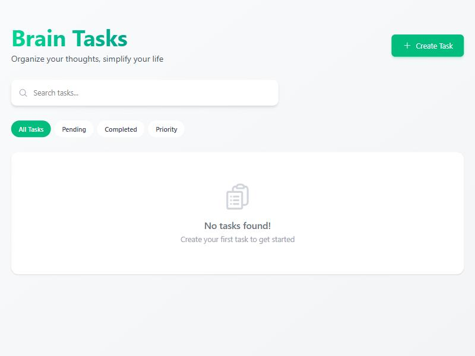

# Brain Tasks App — Production Deployment

A React application deployed to AWS EKS via a CI/CD pipeline using CodeBuild and CodePipeline.

## Architecture Overview

```
GitHub Repo → CodePipeline → CodeBuild → ECR (Docker Image) → EKS (Kubernetes)
                                                                    ↓
                                                          LoadBalancer (port 80)
                                                                    ↓
                                                          Nginx container (port 3000)
```

## Project Structure

```
Brain-Tasks-App/
├── dist/                        # Production-ready React build
│   ├── index.html
│   ├── vite.svg
│   └── assets/
│       ├── index-BHGiHu50.js
│       └── index-DPTLVrPB.css
├── k8s/
│   ├── deployment.yaml          # Kubernetes Deployment (2 replicas)
│   └── service.yaml             # Kubernetes Service (LoadBalancer)
├── Dockerfile                   # Multi-stage Nginx container
├── nginx.conf                   # Nginx config (serves on port 3000)
├── buildspec.yml                # CodeBuild build specification
├── codebuild-trust-policy.json  # IAM trust policy for CodeBuild role
├── codebuild-policy.json        # IAM permissions for CodeBuild role
├── aws-setup-commands.sh        # All AWS CLI commands in order
└── README.md
```

## Prerequisites

- AWS CLI v2 configured with credentials
- Docker installed locally
- kubectl installed
- eksctl installed ([installation guide](https://eksctl.io/installation/))
- Git

## Setup Instructions

### Step 1: Create ECR Repository

```bash
aws ecr create-repository \
  --repository-name brain-tasks-app \
  --region ap-south-1
```

### Step 2: Build & Test Docker Image Locally

```bash
# Build the image
docker build -t brain-tasks-app .

# Run locally to test (visit http://localhost:3000)
docker run -p 3000:3000 brain-tasks-app
```

### Step 3: Push Docker Image to ECR

```bash
# Login to ECR
aws ecr get-login-password --region ap-south-1 | \
  docker login --username AWS --password-stdin 009075573616.dkr.ecr.ap-south-1.amazonaws.com

# Tag and push
docker tag brain-tasks-app:latest \
  009075573616.dkr.ecr.ap-south-1.amazonaws.com/brain-tasks-app:latest

docker push 009075573616.dkr.ecr.ap-south-1.amazonaws.com/brain-tasks-app:latest
```

### Step 4: Create EKS Cluster

```bash
eksctl create cluster \
  --name brain-tasks-cluster \
  --region ap-south-1 \
  --version 1.31 \
  --nodegroup-name brain-tasks-nodes \
  --node-type t3.medium \
  --nodes 2 \
  --nodes-min 1 \
  --nodes-max 3 \
  --managed
```

Verify the cluster is running:

```bash
aws eks describe-cluster --name brain-tasks-cluster --region ap-south-1 --query "cluster.status"
# Expected output: "ACTIVE"

kubectl get nodes
```

### Step 5: Deploy to EKS

```bash
# Update kubeconfig
aws eks update-kubeconfig --name brain-tasks-cluster --region ap-south-1

# Deploy
kubectl apply -f k8s/deployment.yaml
kubectl apply -f k8s/service.yaml

# Verify
kubectl get deployments
kubectl get pods
kubectl get svc brain-tasks-app-service
```

Get the application LoadBalancer URL:

```bash
kubectl get svc brain-tasks-app-service \
  -o jsonpath='{.status.loadBalancer.ingress[0].hostname}'
```

### Step 6: Create CodeBuild IAM Role

```bash
# Create the role
aws iam create-role \
  --role-name codebuild-brain-tasks-role \
  --assume-role-policy-document file://codebuild-trust-policy.json

# Attach the policy
aws iam put-role-policy \
  --role-name codebuild-brain-tasks-role \
  --policy-name codebuild-brain-tasks-policy \
  --policy-document file://codebuild-policy.json
```

### Step 7: Create CodeBuild Project

```bash
aws codebuild create-project \
  --name brain-tasks-app-build \
  --source type=GITHUB,location=https://github.com/Lakshmiparamesh/Brain-Tasks-App.git \
  --artifacts type=NO_ARTIFACTS \
  --environment type=LINUX_CONTAINER,computeType=BUILD_GENERAL1_SMALL,image=aws/codebuild/amazonlinux2-x86_64-standard:5.0,privilegedMode=true \
  --service-role codebuild-brain-tasks-role \
  --region ap-south-1
```

> **Note:** `privilegedMode=true` is required for Docker builds inside CodeBuild.

### Step 8: Create CodePipeline (AWS Console)

1. Go to **AWS CodePipeline** → **Create pipeline**
2. **Source Stage:**
   - Provider: GitHub (Version 2)
   - Connect your GitHub account
   - Repository: `Lakshmiparamesh/Brain-Tasks-App`
   - Branch: `main`
3. **Build Stage:**
   - Provider: AWS CodeBuild
   - Project: `brain-tasks-app-build`
4. **Deploy Stage:**
   - Skip (deployment is handled by `kubectl` in buildspec.yml)
5. Click **Create pipeline**

### Step 9: Grant EKS Access to CodeBuild Role

For CodeBuild to run `kubectl` commands, the CodeBuild role needs EKS access:

```bash
# Edit the aws-auth ConfigMap
kubectl edit configmap aws-auth -n kube-system
```

Add this under `mapRoles`:

```yaml
- rolearn: arn:aws:iam::009075573616:role/codebuild-brain-tasks-role
  username: codebuild
  groups:
    - system:masters
```

## CI/CD Pipeline Flow

```
1. Developer pushes code to GitHub (main branch)
2. CodePipeline detects the change
3. CodeBuild starts:
   a. Logs in to ECR
   b. Builds Docker image
   c. Pushes image to ECR
   d. Updates kubeconfig for EKS
   e. Applies Kubernetes manifests (kubectl apply)
   f. Waits for rollout to complete
4. Application is live on the LoadBalancer URL
```

## Monitoring with CloudWatch

CodeBuild logs are automatically available in CloudWatch:

```bash
# Log group: /aws/codebuild/brain-tasks-app-build

# View latest build logs
aws logs describe-log-streams \
  --log-group-name /aws/codebuild/brain-tasks-app-build \
  --order-by LastEventTime \
  --descending \
  --limit 5

# View EKS application logs
kubectl logs -l app=brain-tasks-app --tail=100
```

## Version Control — Push to GitHub

```bash
git init
git add .
git commit -m "Add deployment configuration for EKS CI/CD pipeline"
git remote add origin https://github.com/Lakshmiparamesh/Brain-Tasks-App.git
git branch -M main
git push -u origin main
```

## LoadBalancer ARN

After deployment, retrieve the LoadBalancer ARN:

```bash
# Get the LoadBalancer hostname
kubectl get svc brain-tasks-app-service -o jsonpath='{.status.loadBalancer.ingress[0].hostname}'

# Get the LoadBalancer ARN from AWS
aws elbv2 describe-load-balancers --region ap-south-1 \
  --query "LoadBalancers[?contains(DNSName, 'brain-tasks')].LoadBalancerArn" \
  --output text
```

## Deployment Evidence

### 1. App Running Locally (Docker — port 3000)


### 2. App Running on EKS LoadBalancer



**LoadBalancer URL:** `http://a684c2667e77c41c1839e0b0ec6ff4fa-1305895818.ap-south-1.elb.amazonaws.com`

### 3. ECR Repository

```
Repository URI : 009075573616.dkr.ecr.ap-south-1.amazonaws.com/brain-tasks-app
Image Tag      : latest
Image Size     : ~20 MB
Pushed At      : 2026-11-12T10:09:30 IST
```


### 4. EKS Cluster

```
Cluster Name : brain-tasks-cluster
Status       : ACTIVE
Version      : 1.31
Endpoint     : https://3955590AAE7A87C4C721AE49678186ED.gr7.ap-south-1.eks.amazonaws.com
Nodes        : 2 (t3.medium, Amazon Linux 2023)
  - ip-192-168-32-149.ap-south-1.compute.internal  (Ready)
  - ip-192-168-67-110.ap-south-1.compute.internal  (Ready)
```


### 5. Kubernetes Pods & Service

```
PODS:
NAME                               READY   STATUS    NODE
brain-tasks-app-5dd4c6854c-lnggq   1/1     Running   ip-192-168-32-149
brain-tasks-app-5dd4c6854c-tm9gr   1/1     Running   ip-192-168-67-110

SERVICE:
NAME                      TYPE           EXTERNAL-IP
brain-tasks-app-service   LoadBalancer   a684c2667e77c41c1839e0b0ec6ff4fa-1305895818.ap-south-1.elb.amazonaws.com
```


### 6. CodeBuild Project — Build Succeeded

```
Project   : brain-tasks-app-build
Source    : https://github.com/Lakshmiparamesh/Brain-Tasks-App.git
Status    : SUCCEEDED
Start     : 2026-11-12T10:09:05 IST
End       : 2026-11-12T10:09:35 IST
```


### 7. CodePipeline — All Stages Succeeded

```
Stage    Status
------   ---------
Source   Succeeded
Build    Succeeded
```


### 8. CloudWatch Logs

```
Log Group: /aws/codebuild/brain-tasks-app-build
```


### 9. GitHub Repository


## Screenshots Guide

Take these screenshots from the **AWS Console** (ap-south-1 region) and save them in the `screenshots/` folder:

| # | Screenshot | AWS Console URL |
|---|-----------|-----------------|
| 3 | ECR Repository | ECR → Repositories → brain-tasks-app → Images |
| 4 | EKS Cluster | EKS → Clusters → brain-tasks-cluster |
| 5 | kubectl pods & service | Terminal: `kubectl get pods` and `kubectl get svc` |
| 6 | CodeBuild success | CodeBuild → brain-tasks-app-build → Build history |
| 7 | CodePipeline | CodePipeline → brain-tasks-app-pipeline |
| 8 | CloudWatch logs | CloudWatch → Log groups → /aws/codebuild/brain-tasks-app-build |
| 9 | GitHub repo | https://github.com/Lakshmiparamesh/Brain-Tasks-App |

## LoadBalancer Details

```
DNS Name : a684c2667e77c41c1839e0b0ec6ff4fa-1305895818.ap-south-1.elb.amazonaws.com
LB Name  : a684c2667e77c41c1839e0b0ec6ff4fa
VPC      : vpc-00a45850233f41ae0
AZs      : ap-south-1a, ap-south-1b, ap-south-1c
```

## Key Details

| Item                | Value                                                                 |
|---------------------|-----------------------------------------------------------------------|
| AWS Account ID      | 009075573616                                                          |
| Region              | ap-south-1 (Mumbai)                                                   |
| ECR Repository      | 009075573616.dkr.ecr.ap-south-1.amazonaws.com/brain-tasks-app        |
| EKS Cluster         | brain-tasks-cluster (v1.31)                                           |
| EKS Endpoint        | https://3955590AAE7A87C4C721AE49678186ED.gr7.ap-south-1.eks.amazonaws.com |
| App Port            | 3000 (container) → 80 (LoadBalancer)                                  |
| LoadBalancer URL    | a684c2667e77c41c1839e0b0ec6ff4fa-1305895818.ap-south-1.elb.amazonaws.com |
| Replicas            | 2                                                                     |
| Node Type           | t3.medium                                                             |
| CodeBuild Project   | brain-tasks-app-build                                                 |
| CodePipeline        | brain-tasks-app-pipeline                                              |
| CloudWatch Logs     | /aws/codebuild/brain-tasks-app-build                                  |
